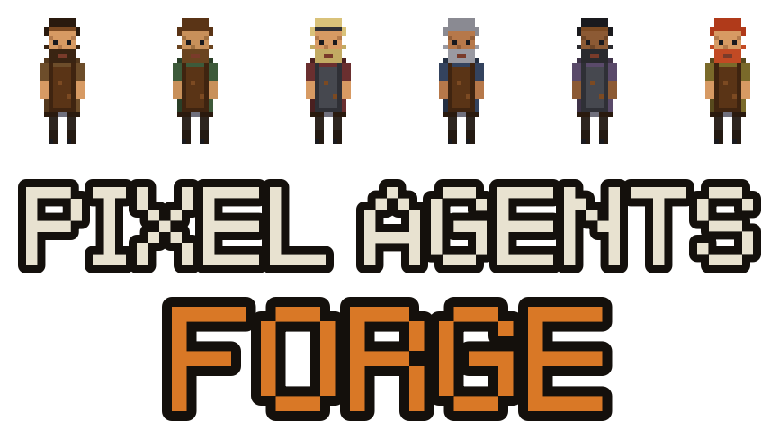
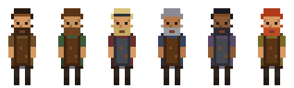

<h1 align="center">
    <a href="https://github.com/beramm/pixel-agents-forge">
        
    </a>
</h1>

<h2 align="center" style="padding-bottom: 20px;">
  ⚒ The forge where AI agents hammer out real things
</h2>

<div align="center" style="margin-top: 25px;">

[](https://github.com/beramm/pixel-agents-forge/stargazers)
[](https://github.com/beramm/pixel-agents-forge/commits/main)
[](LICENSE)
[](https://github.com/pixel-agents-hq/pixel-agents)

</div>

<div align="center">
<a href="#quick-start">⚡ Quick start</a> • <a href="https://github.com/beramm/pixel-agents-forge/issues">🐛 Issues</a> • <a href="CONTRIBUTING.md">🤝 Contributing</a> • <a href="CHANGELOG.md">📋 Changelog</a> • <a href="https://github.com/pixel-agents-hq/pixel-agents">⬆️ Upstream</a>
</div>

<br/>

> ### ⚒ This is a fork
>
> `pixel-agents-forge` is a fork of [pixel-agents-hq/pixel-agents](https://github.com/pixel-agents-hq/pixel-agents) (MIT),
> which is the project that does all the heavy lifting here. This fork reskins the office as a blacksmith
> **forge and tavern**: agents are smiths at the anvil, a **Work Orders** board tracks who is hammering what,
> and the villagers heckle them between rounds at the bar.
>
> **It is not published anywhere.** The `pixel-agents` npm package and the VS Code Marketplace extension are
> upstream's, and installing those gets you upstream's office, not this forge. Build this fork from source —
> see [Quick start](#quick-start).

## Quick start

```bash
git clone https://github.com/beramm/pixel-agents-forge.git && cd pixel-agents-forge && npm install && npm run build && node dist/cli.js --port 3100
```

Then open <http://127.0.0.1:3100>. Day-to-day commands:

```bash
npm run build                  # full build (protocol codegen, types, lint, esbuild, vite)
node dist/cli.js --port 3100   # run the standalone forge
npm run watch                  # esbuild + tsc watch (VS Code extension development)
npm test                       # server + webview unit tests
npm run e2e                    # Playwright suite
```

### Keyboard shortcuts

| Key                 | Where         | Action                                       |
| ------------------- | ------------- | -------------------------------------------- |
| `R`                 | Layout editor | Rotate the ghost / selected furniture        |
| `T`                 | Layout editor | Toggle furniture on/off state                |
| `Ctrl+Z` / `Ctrl+Y` | Layout editor | Undo / redo (50 levels)                      |
| `Esc`               | Layout editor | Step back out: pick → catalog → tab → editor |
| Middle-drag         | Anywhere      | Pan the camera                               |
| `Ctrl+C`            | Standalone    | Stop the server, leaving other surfaces up   |

### Fork-specific settings

Settings modal, on top of upstream's:

- **NPC Chatter** — average seconds between ambient villager speech bubbles; `0` silences them. Smith quips are unaffected.
- **Idle Smith Timeout** — minutes of inactivity before a smith leaves the Work Orders board and despawns; `0` never removes them. An agent mid-tool, waiting, or awaiting permission is never swept.

---

Pixel Agents turns multi-agent AI systems into something you can actually see and manage. Each agent becomes a character in a pixel art world. They walk around, sit at their station, and visually reflect what they are doing — typing when writing code, reading when searching files, waiting when it needs your attention. In this fork that world is a **forge and tavern**, and the agents are smiths.

Both surfaces build **from the same source tree**, and in this fork both are built locally:

- **VS Code extension** — run it from source with **F5** (Extension Development Host), or package a `.vsix` with `npm run package`. Agents spawn into VS Code terminals; characters render in the panel area.
- **Standalone CLI** — `node dist/cli.js` runs a local Fastify server and serves the forge as a browser SPA. Useful in tmux workflows, remote sessions, or any environment without a desktop VS Code.

Internally, the architecture is fully agent-agnostic and platform-agnostic: a typed `HookProvider` interface defines the integration boundary so adding a new AI tool is a single subdirectory of code. Claude Code is the reference implementation today; Codex, Gemini, Cursor, and others are on the roadmap.


## Features

- **One agent, one character** — every Claude Code terminal gets its own animated character
- **Live activity tracking** — characters animate based on what the agent is actually doing (writing, reading, running commands)
- **Office layout editor** — design your office with floors, walls, and furniture using a built-in editor
- **Speech bubbles** — visual indicators when an agent is waiting for input or needs permission
- **Sound notifications** — optional chime when an agent finishes its turn
- **Sub-agent visualization** — Task tool sub-agents spawn as separate characters linked to their parent
- **Persistent layouts** — your office design is saved and shared across VS Code windows
- **External asset directories** — load custom or third-party furniture packs from any folder on your machine
- **Work Orders board** — a panel listing every smith at the anvil and the task they're hammering; click a row to select that smith
- **A tavern that runs itself** — villagers wander in for a drink, get progressively drunk, play cards, and a band plays in the corner
- **Ambient chatter** — NPCs heckle working smiths by name and task; rate is a slider, and `0` shuts them up
- **Idle smiths leave** — an agent with no activity for N minutes is taken off the board and despawns, then walks back in when its session gets busy again
- **Diverse characters** — 6 diverse characters. These are based on the amazing work of [JIK-A-4, Metro City](https://jik-a-4.itch.io/metrocity-free-topdown-character-pack).

<p align="center">
  
</p>

## Requirements

- [Claude Code CLI](https://docs.anthropic.com/en/docs/claude-code) installed and configured
- **VS Code extension:** VS Code 1.105.0 or later
- **Standalone CLI:** Node.js 20 or later
- **Platform:** Windows, Linux, and macOS are supported

## Getting Started

### VS Code extension

Build from source (see [Install from source](#install-from-source)), then press **F5** to launch the Extension Development Host and open the **Pixel Agents** panel. `npm run package` produces an installable `.vsix`.

### Standalone CLI

After building, run the browser-based forge:

```bash
node dist/cli.js
```

It chooses a free local port and prints the exact URL to open. To use a predictable port instead:

```bash
node dist/cli.js --port 3100
# Open http://127.0.0.1:3100
```

> Upstream publishes `npx pixel-agents`, which runs **their** office. This fork is source-only.

Other options:

```text
--port, -p <number>   Use a fixed port instead of an OS-assigned free port
--host <address>      Bind address (default: 127.0.0.1)
--help                Show CLI help
```

The extension and standalone CLI can run at the same time, including when the extension starts first. Each server registers separately under `~/.pixel-agents/servers/`; Claude hook events fan out to both, while each surface adopts only the sessions in its own workspace when **Watch All Sessions** is off. Hooks are enabled by default, and each surface persists its own Hooks setting under the shared `~/.pixel-agents/config.json` file.

Settings and layouts persist under `~/.pixel-agents/`. Stop standalone with **Ctrl+C**; it removes its own server registration without disrupting a running extension.

> Binding to `0.0.0.0` exposes the standalone UI and WebSocket to other machines on the network. Use the default loopback address unless remote access is intentional and the surrounding network is trusted.

### Install from source

```bash
git clone https://github.com/beramm/pixel-agents-forge.git
cd pixel-agents-forge
npm install      # npm workspaces installs root + server + webview-ui in one shot
npm run build
```

Then press **F5** in VS Code to launch the Extension Development Host.

To run the standalone bundle built from source:

```bash
node dist/cli.js
```

### Browser Preview & Hosted Reports

The browser-preview version of the webview can be built and staged for Vercel separately from the VS Code extension build.

```bash
npm run test
npm run e2e
npm run e2e -- --attach-videos-on-success
npm run vercel:prepare
```

Run `npm run test:report` separately when you want the combined Allure report locally without preparing the full Vercel output.

The staged Vercel output serves the standalone webview at `/webview/` and the Linux Allure report at `/reports/allure/`, combining the `e2e`, `server`, and `webview` suites. The GitHub Actions deploy job expects `VERCEL_TOKEN`, `VERCEL_ORG_ID`, and `VERCEL_PROJECT_ID` secrets.

### Usage

1. Open the **Pixel Agents** panel (it appears in the bottom panel area alongside your terminal)
2. Click **+ Agent** to spawn a new Claude Code terminal and its character. Right-click for the option to launch with `--dangerously-skip-permissions` (bypasses all tool approval prompts)
3. Start coding with Claude — watch the character react in real time
4. Click a character to select it, then click a seat to reassign it
5. Click **Layout** to open the office editor and customize your space

## Layout Editor

The built-in editor lets you design your office:

- **Floor** — Full HSB color control
- **Walls** — Auto-tiling walls with color customization
- **Tools** — Select, paint, erase, place, eyedropper, pick
- **Undo/Redo** — 50 levels with Ctrl+Z / Ctrl+Y
- **Export/Import** — Share layouts as JSON files via the Settings modal

The grid is expandable up to 64×64 tiles. Click the ghost border outside the current grid to grow it.

### Office Assets

All office assets (furniture, floors, walls) are now **fully open-source** and included in this repository under `webview-ui/public/assets/`. No external purchases or imports are needed — everything works out of the box.

Each furniture item lives in its own folder under `assets/furniture/` with a `manifest.json` that declares its sprites, rotation groups, state groups (on/off), and animation frames. Floor tiles are individual PNGs in `assets/floors/`, and wall tile sets are in `assets/walls/`. This modular structure makes it easy to add, remove, or modify assets without touching any code.

To add a new furniture item, create a folder in `webview-ui/public/assets/furniture/` with your PNG sprite(s) and a `manifest.json`, then rebuild. The asset manager (`scripts/asset-manager.html`) provides a visual editor for creating and editing manifests.

To use furniture from an external directory, open Settings → **Add Asset Directory**. See [docs/external-assets.md](docs/external-assets.md) for the full manifest format and how to use third-party asset packs.

Characters are based on the amazing work of [JIK-A-4, Metro City](https://jik-a-4.itch.io/metrocity-free-topdown-character-pack).

## How It Works

Pixel Agents has two parallel detection paths:

- **Hooks mode** (preferred) — Claude Code's official Hooks API POSTs events (`SessionStart`, `PreToolUse`, `Notification`, `Stop`, etc.) to local Fastify servers (`POST /api/hooks/:providerId`). Live servers register under `~/.pixel-agents/servers/`, and the hook script fans out to all valid entries so the extension and standalone can coexist. `~/.pixel-agents/server.json` remains as a legacy single-server fallback.
- **Heuristic mode** (fallback) — Polls JSONL transcript files at `~/.claude/projects/<project-hash>/<session-id>.jsonl`. Used when hooks aren't installed.

A single `HookProvider.normalizeHookEvent(raw)` translates each CLI's hook payload into a canonical `AgentEvent`. The shared `AgentRuntime` dispatches on `AgentEvent.kind`, mutates `AgentStateStore`, and the broadcast layer translates state events into typed `ServerMessage` over the active transport.

The webview runs a lightweight game loop with canvas rendering, BFS pathfinding, and a character state machine (idle → walk → type/read). Everything is pixel-perfect at integer zoom levels. Game state lives in an imperative `OfficeState` class outside React; React components read from it during render but don't own the state.

No modifications to Claude Code are needed — Pixel Agents is purely observational.

## Tech Stack

Four-package monorepo, npm workspaces:

- **`core/`** — TypeScript-only protocol + interfaces (AsyncAPI 3.0 contract, `HookProvider`, `MessageTransport`, `StateAdapter`). Zero runtime side effects.
- **`server/`** — Fastify v5 (HTTP + WebSocket), Vitest. Owns `AgentRuntime`, `AgentStateStore`, `SessionRouter`, `DismissalTracker`, file watching, transcript parsing, providers. Ships the standalone CLI (`node dist/cli.js`).
- **`adapters/vscode/`** — VS Code Extension API. Composes `core/` + `server/` for the desktop surface.
- **`webview-ui/`** — React 19, Vite, Canvas 2D. Transport-agnostic (`PostMessageTransport` in VS Code, `WebSocketTransport` in the browser).

Builds: esbuild (extension + CLI + hook scripts), Vite (webview SPA). Tests: Vitest (server + webview unit), Playwright (e2e against real VS Code + standalone Fastify).

## Known Limitations

- **Agent-terminal sync** — the way agents are connected to Claude Code terminal instances is not super robust and sometimes desyncs, especially when terminals are rapidly opened/closed or restored across sessions.
- **Heuristic-based status detection** — Claude Code's JSONL transcript format does not provide clear signals for when an agent is waiting for user input or when it has finished its turn. The current detection is based on heuristics (idle timers, turn-duration events) and often misfires — agents may briefly show the wrong status or miss transitions.
- **Linux/macOS tip** — if you launch VS Code without a folder open (e.g. bare `code` command), agents will start in your home directory. This is fully supported; just be aware your Claude sessions will be tracked under `~/.claude/projects/` using your home directory as the project root.

## Troubleshooting

For standalone startup problems:

1. **Unsupported Node version** — Run `node --version`; standalone requires Node.js 20 or later.
2. **Port already in use** — Omit `--port` to let Pixel Agents choose a free port, or select another fixed port.
3. **Hooks are not active** — Open Settings and confirm **Hooks** is ON. Pixel Agents installs the hook script at `~/.pixel-agents/hooks/claude-hook.js`.
4. **Extension and standalone are both running** — This is supported. Current versions create separate files under `~/.pixel-agents/servers/`; stopping one surface must not remove the other surface's registration.

If your agent appears stuck on idle or doesn't spawn:

1. **Debug View** — In the Pixel Agents panel, click the gear icon (Settings), then toggle **Debug View**. This shows connection diagnostics per agent: JSONL file status, lines parsed, last data timestamp, and file path. If you see "JSONL not found", the extension can't locate the session file.
2. **Debug Console** — If you're running from source (Extension Development Host via F5), open VS Code's **View > Debug Console**. Search for `[Pixel Agents]` to see detailed logs: project directory resolution, JSONL polling status, path encoding mismatches, and unrecognized JSONL record types.

## Where This Is Going

The long-term vision is an interface where managing AI agents feels like playing the Sims, but the results are real things built.

- **Agents as characters** you can see, assign, monitor, and redirect, each with visible roles (designer, coder, writer, reviewer), stats, context usage, and tools.
- **Desks as directories** — drag an agent to a desk to assign it to a project or working directory.
- **An office as a project** — with a Kanban board on the wall where idle agents can pick up tasks autonomously.
- **Deep inspection** — click any agent to see its model, branch, system prompt, and full work history. Interrupt it, chat with it, or redirect it.
- **Token health bars** — rate limits and context windows visualized as in-game stats.
- **Fully customizable** — upload your own character sprites, themes, and office assets. Eventually maybe even move beyond pixel art into 3D or VR.

For this to work, the architecture needs to be modular at every level:

- **Platform-agnostic**: VS Code extension today, Electron app, web app, or any other host environment tomorrow.
- **Agent-agnostic**: Claude Code today, but built to support Codex, OpenCode, Gemini, Cursor, Copilot, and others through composable adapters.
- **Theme-agnostic**: community-created assets, skins, and themes from any contributor.

That roadmap belongs to upstream, and this fork tracks it. To talk about it, visit upstream's [Discussions](https://github.com/pixel-agents-hq/pixel-agents/discussions).

## Community & Contributing

Fork-specific bugs and ideas (the forge, tavern, Work Orders board, chatter, idle sweep) belong in **[this repo's Issues](https://github.com/beramm/pixel-agents-forge/issues)**.

Anything about the underlying engine belongs upstream: **[Issues](https://github.com/pixel-agents-hq/pixel-agents/issues)** and **[Discussions](https://github.com/pixel-agents-hq/pixel-agents/discussions)**. Please report there first when the bug is not caused by this fork's changes.

See [CONTRIBUTING.md](CONTRIBUTING.md) for instructions on how to contribute.

Please read our [Code of Conduct](CODE_OF_CONDUCT.md) before participating.

## Supporting the Project

This fork exists because of upstream's work. If you find Pixel Agents useful, support its author:

<a href="https://github.com/sponsors/pablodelucca">
  
</a>
<a href="https://ko-fi.com/pablodelucca">
  
</a>

## Star History

[](https://www.star-history.com/?repos=pixel-agents-hq%2Fpixel-agents,beramm%2Fpixel-agents-forge&type=date&legend=bottom-right)

## License

This project is licensed under the [MIT License](LICENSE), inherited from [pixel-agents-hq/pixel-agents](https://github.com/pixel-agents-hq/pixel-agents). Copyright notices from upstream are retained.
